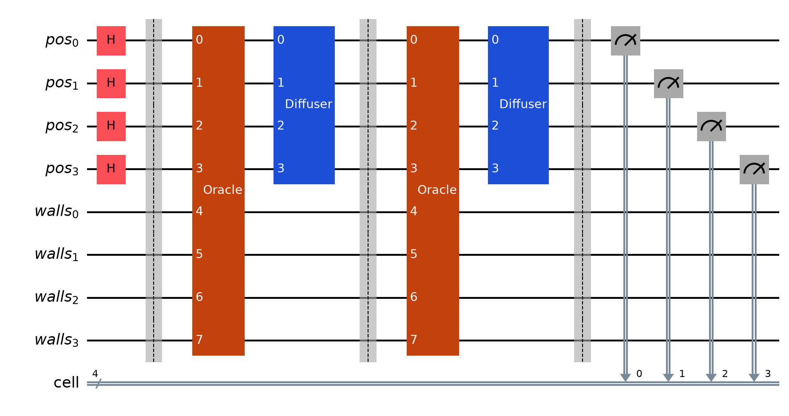
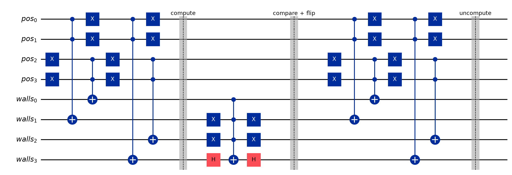
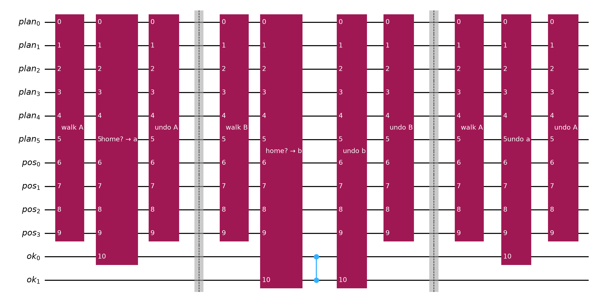
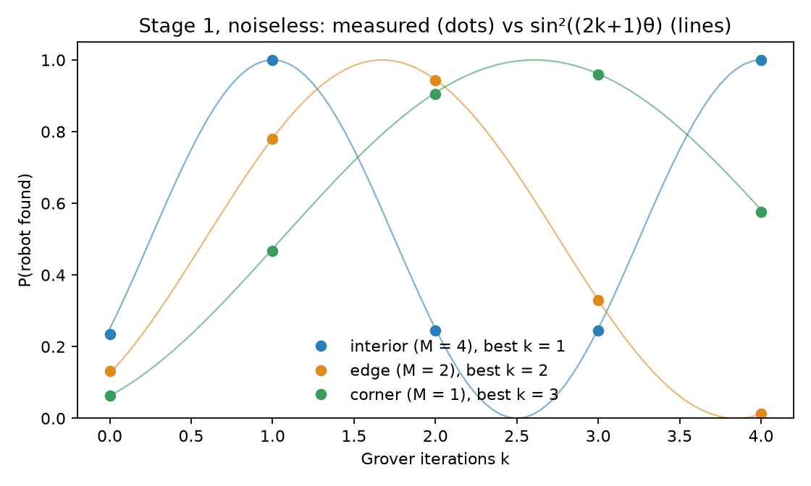
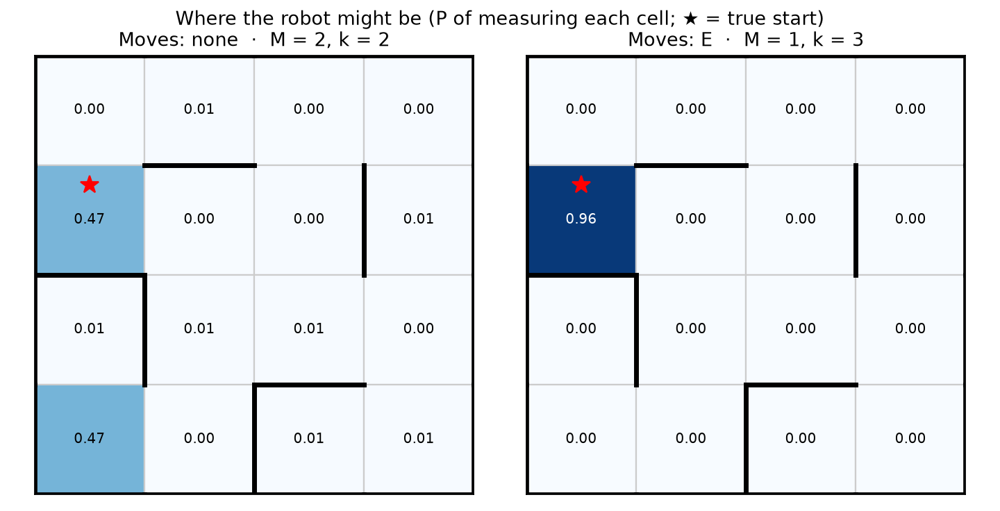
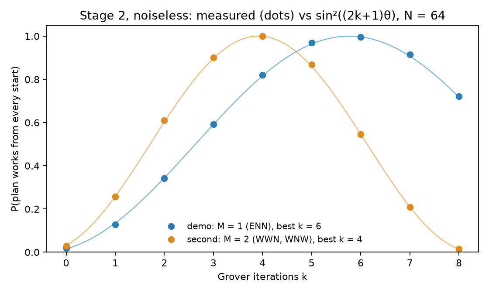
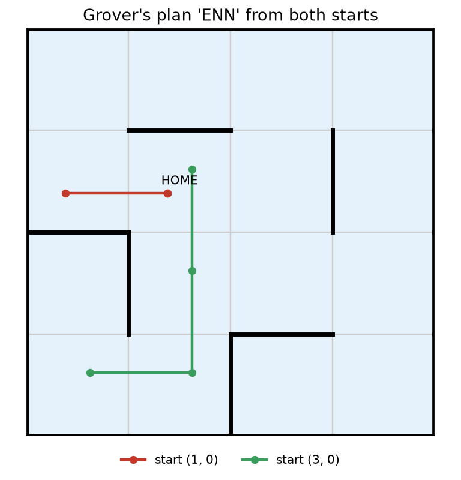
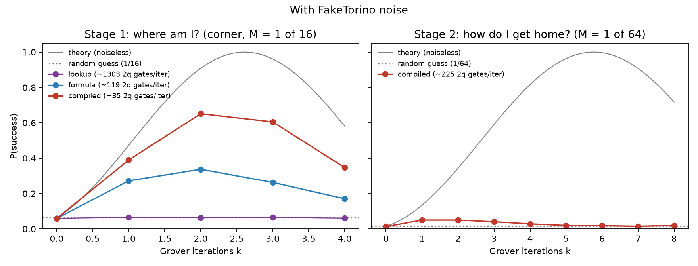
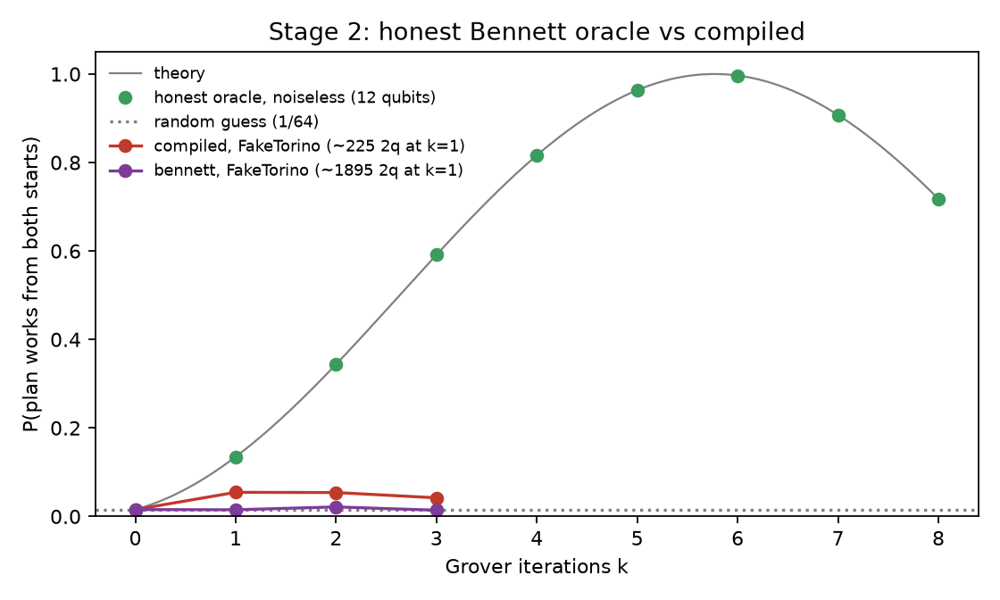

# Just Keep Swimming

A rescue robot, named Dory, is lost in a flooded building. It has a map and a sensor that only tells it which
sides of its cell have walls (N, E, S, W). It runs two Grover searches in Qiskit:

- **Stage 1 · Where am I?** Grover over the 16 cells (4 qubits) finds every cell that matches the
  reading. If several cells look alike, the robot moves, senses again, and the oracle checks both readings.
- **Stage 2 · How do I get home?** Grover over all 64 three-move plans (6 qubits) finds a plan
  that walks the robot home. The same oracle checks the plan from every square the robot might be
  on, so if stage 1 leaves a few lookalikes, one plan gets it home from all of them, no rescan needed.

Both oracles are built with Bennett's construction (compute → copy the answer into a phase or flag →
uncompute): they see only the map and the readings, never the answer.

**TL;DR**
- **Problem:** a rescue robot lost in a known building (the kidnapped-robot problem) only feels which sides of its square have walls.
- **Quantum part:** two Grover searches in Qiskit, over 16 squares (where am I?) and over 64 three-move routes (how do I get home?), with honest Bennett oracles that know only the map.
- **Best honest result:** under FakeTorino noise, the formula oracle finds the robot 34% of the time vs 6% for a random guess, and with 2 oracle queries Grover succeeds 64% of the time vs at most 19% for any classical strategy (compiled oracle).
- **Limits:** the advantage is in oracle queries, not wall-clock time; stage 2 is near random under noise; real-hardware results are still queued at IBM.

**Live demo:** https://lostneedhome.vercel.app 

## Project layout

```
lost_robot/
├── quantum/                    # the Qiskit code
│   ├── stage1.py               #   map, lookup / formula / compiled oracles, diffuser, Grover, theory
│   └── stage2.py               #   plans, compiled + Bennett plan oracles, plan search
├── experiments/                # one script per result; run from the root: python -m experiments.<name>
│   ├── stage1_noiseless.py     #   fig1, fig2, stage1.json
│   ├── stage2_noiseless.py     #   fig3, fig4, stage2.json
│   ├── noise.py                #   fig5, noise.json            (FakeTorino noise, both stages)
│   ├── stage2_bennett.py       #   fig6, stage2_bennett.json   (honest stage-2 oracle, ~15 min)
│   ├── circuit_diagrams.py     #   circuit1–3 (readable circuit drawings)
│   ├── ibm_hardware.py         #   real IBM hardware run (rehearse / submit / fetch)
│   └── precompute_ui.py        #   frontend/js/qdata.js        (all results the demo shows)
├── results/                    # every figure and data file
├── tests/                      # 68 checks: each test is one claim about the circuits
│   ├── test_stage1.py
│   └── test_stage2.py
├── frontend/                   # the demo (static HTML/JS, deployed on Vercel)
└── requirements.txt
```

## Run it

```bash
python -m venv .venv && source .venv/bin/activate
pip install -r requirements.txt
python -m pytest -q                         # ~2 min
python -m experiments.stage1_noiseless      # ~15 s each, except:
python -m experiments.stage2_noiseless
python -m experiments.noise                 # ~30 s
python -m experiments.stage2_bennett        # ~15 min (12-qubit noisy runs)
python -m experiments.precompute_ui         # ~1 min, regenerates the demo's data
python -m http.server 8000 --directory frontend    # demo at http://localhost:8000
```

## The demo

Drag Dory anywhere (2D or 3D) and right-click a square to set home, then press **Start mission**:
Dory scans, runs Grover, decides whether to rescan or plan, draws its route from every place it
might be, and walks home, narrating each step in the caption strip. **Auto / Step** under the map
pauses at every step; **POV** shows the mission through Dory's eyes; **Ideal / Noisy** switches
between exact statevector results and FakeTorino-noise results; **Stats** and the end-of-mission
pop-up compare classical checks with quantum oracle calls.

The heat map, measured percentages and chosen routes come from `frontend/js/qdata.js`, generated by
`experiments/precompute_ui.py` from the building in `frontend/js/world.js` (the script reads the walls
from there, so the demo and Qiskit always agree). The amplitude chart animates the ideal oracle and
diffuser steps in the browser. If the data file is missing, the page falls back to in-browser ideal maths.

## Theory

With M matching items out of N, the start state is |s⟩ = sin θ |w⟩ + cos θ |w⊥⟩ with sin θ = √(M/N).
The oracle reflects about |w⊥⟩ and the diffuser reflects about |s⟩, so each iteration rotates by 2θ:

  **P(found after k iterations) = sin²((2k+1)θ)**, best k ≈ π/(4θ) − ½

| Search | N | M = 1 | M = 2 | M = 4 |
|---|---|---|---|---|
| Stage 1: cells | 16 | k = 3 | k = 2 | k = 1 |
| Stage 2: plans | 64 | k = 6 | k = 4 | k = 3 |

## How the circuits work

**Stage 1 oracle** (`quantum/stage1.py`): compute the wall bits of cell x into ancillas
(`anc ^= walls(x)`), flip the phase if they equal the reading (X on the expected-0 bits, then an
in-place H–MCX–H multi-controlled Z), uncompute. Three versions with the same unitary:

| Oracle | Honest? | How walls(x) is computed | 2q gates/call (all-to-all) |
|---|---|---|---|
| lookup | yes | one 4-controlled X per (cell, wall bit) | 618 |
| formula | yes | each wall bit as a cheapest fixed-polarity Reed–Muller formula (XOR of ANDs) of the position bits | 62 |
| compiled | **no** | one `DiagonalGate` built from the classical answer, a lower bound on cost | 14 |

The whole stage-1 search (k = 2): superposition, then oracle → diffuser twice, then measure.



Inside the honest formula oracle for the corner reading (N + W walls): **compute** the wall bits
from the position bits, **compare** with the reading and flip the phase, **uncompute**. The
uncompute half is the compute half run again, which returns the wall qubits to |0⟩.



**Stage 2 oracle** (`quantum/stage2.py`, 12 qubits: plan 6 + pos 4 + one flag per start):

| Qubit-saving idea | How it shows up |
|---|---|
| Binary cell index | 4 qubits for 16 cells, not one per cell |
| 2 qubits per move | 6 qubits for 64 plans (00 = N, 01 = E, 10 = S, 11 = W) |
| Move 1 needs no position register | the start is known, so the cell after moves 1–2 is a fixed function of the plan's first 4 qubits |
| Move 3 needs no position register | only "does move(pos, m3) land on home?" goes into a flag |
| Ancilla reuse via uncompute | walk A → flag a → undo; walk B reuses the same `pos` qubits |
| In-place phase flip | CZ on the flags (H–MCX–H in general), no extra \|−⟩ qubit |

Inside the honest stage-2 oracle for two possible starts: walk A, copy "home?" into flag a, undo
walk A; walk B on the **same** `pos` qubits, flag b, CZ(a, b) flips the phase only if both reach
home; then everything is undone so every helper qubit is back at |0⟩.



## Results

All figures and data are in `results/`. Noiseless runs use AerSimulator (4,000 shots); noisy runs use
`AerSimulator.from_backend(FakeTorino())`.

**Noiseless: measured matches theory within ~1%.**

| Case | M | k | Theory | Measured |
|---|---|---|---|---|
| Open room, interior | 4 | 1 | 1.000 | 1.000 |
| Open room, edge | 2 | 2 | 0.945 | 0.943 |
| Open room, corner | 1 | 3 | 0.961 | 0.960 |
| Town map, no move (2 lookalikes) | 2 | 2 | 0.945 | 0.940 |
| Town map, one move east | 1 | 3 | 0.961 | 0.962 |
| Stage 2, plan from both starts (ENN) | 1 | 6 | 0.997 | 0.996 |






**With FakeTorino noise** (corner robot / demo plan, M = 1):

| | Qubits | Theory best k | Noisy best k | Noisy P(success) | Random guess | 2q gates / iteration |
|---|---|---|---|---|---|---|
| Stage 1 lookup (honest) | 8 | 3 | – | 0.066 | 0.063 | 1,303 |
| Stage 1 formula (honest) | 8 | 3 | 2 | **0.338** | 0.063 | 119 |
| Stage 1 compiled (not honest) | 4 | 3 | 2 | 0.651 | 0.063 | 35 |
| Stage 2 compiled (not honest) | 6 | 6 | 1–2 | 0.054 | 0.016 | 225 |
| Stage 2 Bennett (honest) | 12 | 6 | – | 0.021 | 0.016 | ~1,900 |




What the noise results show:
1. **Noise moves the best k from 3 to 2.** Each extra iteration adds signal but also gate errors.
2. **Oracle cost decides everything.** The lookup oracle (~1,300 2q gates per iteration) falls to
   random guessing; the formula oracle (119) still finds the robot 5× more often than guessing.
3. **Structure matters.** The open room's walls are simple formulas (north wall = both row bits 0), so
   the formula oracle is 11× cheaper. On the irregular town map it is only ~3× cheaper. By Shannon's
   counting argument most maps need ~N/log N gates, so irregular buildings don't compress.
4. **The search space matters too.** Stage 2 needs twice the iterations, and its 6-qubit diffuser alone
   costs 134 2q gates on Torino (80 all-to-all, the rest SWAP routing), against 18 for 4 qubits.
5. **Pebble-game trade-off.** Giving each start its own `pos` register (16 qubits instead of 12)
   saves 22% of the stage-2 oracle's gates (766 → 599 all-to-all), because walk A no longer has to be
   recomputed to clear its flag.

## Honest limits

- Grover needs ~√(N/M) oracle calls instead of N classical checks, but the oracle must encode the map.
  On irregular maps that costs more gates than Grover saves.
- With discrete wall readings, a classical robot can precompute a reading → squares table once and then
  localize with a single lookup. Grover's advantage here is in **oracle queries** in the unstructured-search
  model, which is what we measure. It becomes practically relevant only for sensors that can't be indexed.
- Grover helps when a reading can only be **checked**, not worked backwards. Landmarks ("red door one
  cell east") can be inverted classically; continuous laser distances can only be checked, which is
  where this approach would scale.
- On today's hardware the quantum computer would be in the cloud, not on the robot.
- Real sensors make mistakes. Extension: accept cells within one wall bit of the reading.

## What's next

**Real IBM hardware results (pending).** The full experiment in `experiments/ibm_hardware.py`
(54 circuits × 4,000 shots: success vs k, all 16 targets, honest oracles, stage 2, with and without
error suppression) is queued on IBM's free plan. The Fall Fest queue is over 20,000 jobs deep. Job IDs, verifiable on
IBM Quantum Platform: ibm_fez `dbo14f0ou4as73b5atrg`, `dbo14f8qtr0c73adqjkg`; backup on ibm_kingston
`dbo1hroqtr0c73adrhb0`, `dbo1hs0qtr0c73adrhbg`. The same pipeline rehearsed on FakeTorino is in
`results/hardware_rehearsal.json` and `results/rehearsal_fig7–9*.png`; measured results will be added here.

Wall-segment oracle (cost ~ walls × log N instead of cells), continuous coordinates with ray casting
and a tolerance ε, coarse-to-fine room-then-cell search, unknown M via randomized k (BBHT) or quantum
counting, and Bennett's pebble game for longer plans.

## References

- L. K. Grover, *A fast quantum mechanical algorithm for database search*, STOC 1996.
- M. Boyer, G. Brassard, P. Høyer, A. Tapp, *Tight bounds on quantum searching*, 1998.
- C. H. Bennett, *Logical reversibility of computation*, IBM J. Res. Dev. 1973.
- S. Thrun, W. Burgard, D. Fox, *Probabilistic Robotics*, MIT Press 2005 (ch. 7–8, robot localization).
